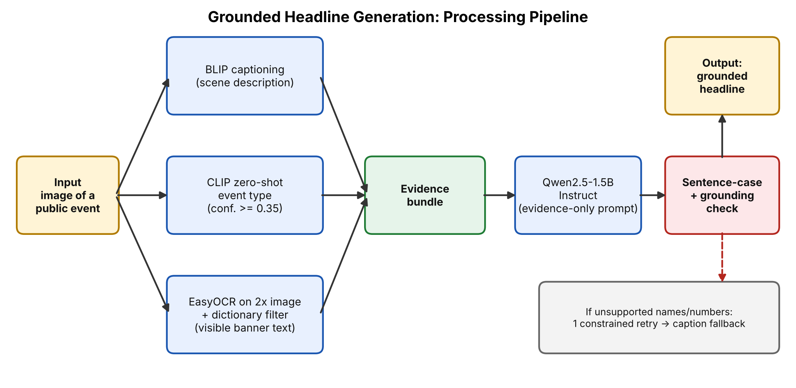

# Grounded Headline Generation from Public Event Images

**LLM Programming Task 20: Headline Generation**
Given an image of a public event, the system generates a descriptive headline **without inventing facts that are not visible in the image**.

## Group Details

| Name | Roll No. | Contribution |
|------|----------|--------------|
| Aditya Kumar | 2330133 | Image captioning (BLIP) and event-type detection (CLIP). Collected the test images and ran the batch tests on Colab. |
| Aman Kumar | 2330065 | Headline generation with Qwen2.5 (prompt design), OCR stage and its noise filter, and the grounding check with retry and fallback. |
| Aman Kumar | 2330361 | Gradio demo app, screenshots, GitHub repository, report, slides and the presentation video. |

## Problem Statement

Language models often invent names, places, dates and causes when writing about images. For news-style headlines this is unacceptable. This project writes a headline from only what is visible in a public-event photo (the scene, the activity and any legible text) and automatically rejects headlines containing unsupported names or numbers.

## Processing Pipeline



```
Image
  ├─► BLIP captioning ──────────┐
  ├─► CLIP zero-shot event type ├─► Evidence bundle ─► Qwen2.5-1.5B-Instruct ─► Sentence-case fix ─► Grounding check ─► Headline
  └─► EasyOCR (banners/signs) ──┘                                                                         │ fail
                                                                                      one constrained retry ─► caption fallback
```

1. **Captioning:** `Salesforce/blip-image-captioning-large` describes the scene.
2. **Event typing:** `openai/clip-vit-base-patch32` scores the image against 15 generic event labels (political rally, protest march, concert, running race, press conference, etc.). A label is used only if its probability is at least 0.35.
3. **OCR:** EasyOCR reads text on a 2x upscaled copy of the image. Only detections with confidence ≥ 0.4 are kept, and only alphabetic dictionary words of 3+ letters (checked with `pyspellchecker`), which removes OCR noise.
4. **Headline writing:** `Qwen/Qwen2.5-1.5B-Instruct` receives the evidence (caption, event type, visible text) and a system prompt forbidding facts outside it. Greedy decoding.
5. **Formatting:** the output is converted to sentence case. Words stay capitalised only if they appear capitalised in the OCR text.
6. **Grounding check:** every number and every capitalised non-initial word in the headline must appear in the evidence. If not, the model is retried once with the unsupported words banned. If it still fails, the system falls back to a cleaned version of the BLIP caption.

## Models and Tools

| Component | Model / library | Link |
|-----------|-----------------|------|
| Captioning | Salesforce/blip-image-captioning-large | https://huggingface.co/Salesforce/blip-image-captioning-large |
| Event typing | openai/clip-vit-base-patch32 | https://huggingface.co/openai/clip-vit-base-patch32 |
| Headline LLM | Qwen/Qwen2.5-1.5B-Instruct | https://huggingface.co/Qwen/Qwen2.5-1.5B-Instruct |
| OCR | EasyOCR | https://github.com/JaidedAI/EasyOCR |
| OCR filtering | pyspellchecker | https://pypi.org/project/pyspellchecker/ |
| UI | Gradio | https://www.gradio.app |

Environment: Python 3, PyTorch, Hugging Face Transformers, Google Colab (T4 GPU).
**Datasets:** none. All models are used as released, with no training or fine-tuning. The test images in `samples/` were collected from the web and are used only for academic demonstration.

## How to Run

```bash
git clone <this-repo-url>
cd <repo-folder>
pip install -r requirements.txt
python app.py
```
This opens a Gradio web app: upload an image and click **Submit**.

Or use it directly in Python or a notebook:
```python
from PIL import Image
from headline_generator import HeadlineGenerator

g = HeadlineGenerator()
print(g.generate(Image.open("samples/images.jpg")).to_dict())
```
On Google Colab, choose **Runtime → Change runtime type → T4 GPU** first. The first run downloads about 5 GB of models. For a public demo link, use `demo.launch(share=True)`.

### Batch run on all sample images
```python
import os, glob, csv
from PIL import Image
os.makedirs("outputs", exist_ok=True)
rows = []
for p in sorted(glob.glob("samples/*")):
    if p.lower().endswith((".jpg", ".jpeg", ".png", ".webp")):
        r = g.generate(Image.open(p)).to_dict()
        r["image"] = os.path.basename(p)
        rows.append(r)
with open("outputs/results.csv", "w", newline="", encoding="utf-8") as f:
    w = csv.DictWriter(f, fieldnames=list(rows[0].keys()))
    w.writeheader(); w.writerows(rows)
```

## Sample Inputs and Outputs

Inputs are in `samples/`. Full results (caption, event type, OCR text, flags) are in `outputs/results.csv`. The final headlines on the 8 test images are below, with our own manual assessment.

| Image | Generated headline | Fallback used? | Assessment |
|-------|--------------------|----------------|------------|
| download.jpg | A bustling market thrives with shoppers | No | Mostly fine; "bustling" and "thrives" are interpretation |
| images (1).jpg | Protesters march for fossil march | No | **Wrong**: OCR fragments of the banner were merged into a meaningless phrase |
| images (2).jpg | Aerial view shows religious festival crowd procession | No | "Religious" comes from the CLIP guess, not legible text |
| images (3).jpg | Crowd watches band perform at concert | No | Good |
| images (4).jpg | Men squatting during squash game | No | Doubtful; sport and "squatting" come from the captioner |
| images (5).jpg | Group of men run marathon race city street | No | "Marathon" is a specific claim from a visual guess |
| images (6).jpg | People sit in chairs during a press conference | No | Good, generic but accurate |
| images.jpg | Man speaks at political rally before large crowd | No | Good |

The assessment is a manual judgement on a small set of images. No accuracy score was computed.

### Demo screenshots (`screenshots/`)

1. **Political rally:** caption and event type correct (rally, 80%); the headline passed the grounding check.
2. **Press conference (earlier version of the code):** OCR returned only noise ("ROND"), the first LLM headline contained unsupported content, and the system fell back to the caption. This shows the grounding check working as designed.
3. **Climate march (earlier version of the code):** the banner is legible but OCR returned only "MARcH", so the headline stayed generic, and the model wrote it in capital letters. The capitals issue was fixed afterwards (see below). The OCR issue was only partly fixed.

## Improvements Made During Testing

| Observation | Fix |
|-------------|-----|
| Headlines sometimes came out in ALL CAPS or Title Case | Added a sentence-case step that keeps capitals only for words capitalised in the OCR text |
| Fallback captions began with "There is…" / "This is…" | Strip these prefixes in the fallback |
| OCR missed small or angled banner text | Upscale the image 2x before OCR; confidence threshold lowered to 0.4 |
| OCR noise such as "GMERICAN" reached the evidence and the headline | Keep only dictionary words of 3+ letters (`pyspellchecker`) |
| "Marathon" was a specific claim from a visual guess | CLIP label changed to the more general "a running race" |

## Limitations

- **The grounding check is lexical.** It compares words, so it cannot tell that a headline is wrong when every word appears in the evidence. This happened on the climate march image ("Protesters march for fossil march").
- It also cannot catch unsupported adjectives or causes (for example "bustling" and "thrives").
- OCR still struggles with large stylised, angled or repeated text, so the best fact in a photo can be missed.
- BLIP can mislabel details such as the sport being played or what people are doing, and the headline inherits the error.
- The event type is a zero-shot guess and can add a specific word (such as "religious") that the image does not make explicit.
- The system does not identify people, places or dates by design, so headlines stay general unless text is legible.
- The test set is small (8 images), so the results are illustrative only.

## Future Scope

- Replace the multi-stage pipeline with a single vision-language model (e.g., Qwen2-VL).
- Add an entailment (NLI) based faithfulness check to catch unsupported adjectives and meaning errors.
- Use a stronger OCR model tuned for banners and signs.
- Multilingual headlines (Hindi and other Indian languages) and multilingual OCR.
- Evaluate on a larger image set with human ratings for fluency and faithfulness.

## Repository Contents

```
├── headline_generator.py    # pipeline
├── app.py                   # Gradio demo
├── requirements.txt
├── README.md
├── pipeline_diagram.png     # block diagram
├── samples/                 # input images
├── outputs/results.csv      # generated headlines
├── screenshots/             # demo screenshots
├── REPORT.pdf               # project report
├── slides.pdf               # presentation slides
└── VIDEO_LINK.md            # presentation + demo video link (or Release link)
```

## Presentation and Demo Video

Link: _(paste the video link here)_

## References

- Li et al., "BLIP: Bootstrapping Language-Image Pre-training for Unified Vision-Language Understanding and Generation", 2022.
- Radford et al., "Learning Transferable Visual Models From Natural Language Supervision" (CLIP), 2021.
- Qwen Team, "Qwen2.5 Technical Report", 2024.
- EasyOCR, JaidedAI. Hugging Face Transformers.
